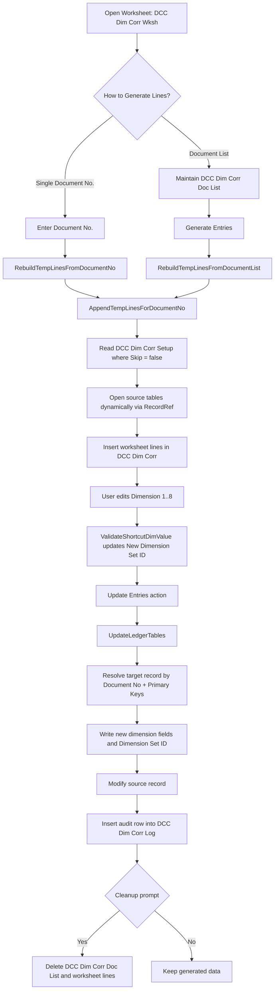

# DCC Dimension Correction

This extension provides a controlled way to correct dimensions on posted documents and related ledger entries in Business Central.

It uses a setup-driven mapping between table fields and dimension fields, generates editable worksheet lines, and applies updates with an audit log.

## Installation

Download the zip from [Releases](https://github.com/rpshbhandari/Dimension-Correction/releases), extract the `.app` and deploy it to your Business Central environment.

## Main Objects

- Table `60100` - `DCC Dim Corr Setup`: Stores per-table field mapping (document no., primary keys, dimension fields, dimension set id field).
- Table `60101` - `DCC Dim Corr`: Temporary/working lines used in the worksheet.
- Table `60102` - `DCC Dim Corr Log`: Stores applied change history.
- Table `60103` - `DCC Dim Corr Doc List`: Stores a list of document numbers for batch generation.
- Page `60103` - `DCC Dim Corr Wksh`: Main worksheet for generating, editing, and applying corrections.
- Codeunit `60100` - `DCC Dim Corr Mgt`: Core generation/import/export/update logic.
- Codeunit `60101` - `SetupFields Helper`: Seeds default setup mappings.

## Process Flow

## Typical Usage

1. Open **DCC Dimension Correction Worksheet**.
2. Ensure **DCC Dim Corr Setup** is configured (or initialize via `SetupFields Helper`).
3. Generate lines:
   - Enter one document no. for targeted correction, or
   - Add multiple document no. values in document list and run **Generate Entries**.
4. Review lines and adjust Dimension 1..8 values as needed.
5. Run **Update Entries** to apply changes.
6. Review **Correction Log** for traceability.

## Notes

- Setup must include at least one primary key field and document no. field for each target table.
- The update logic applies only to tables configured with `Skip = false`.
- Excel import/export actions are available in on-prem environments from the worksheet page.
